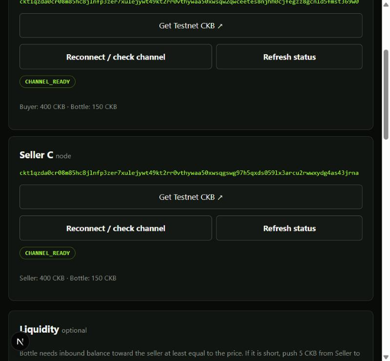
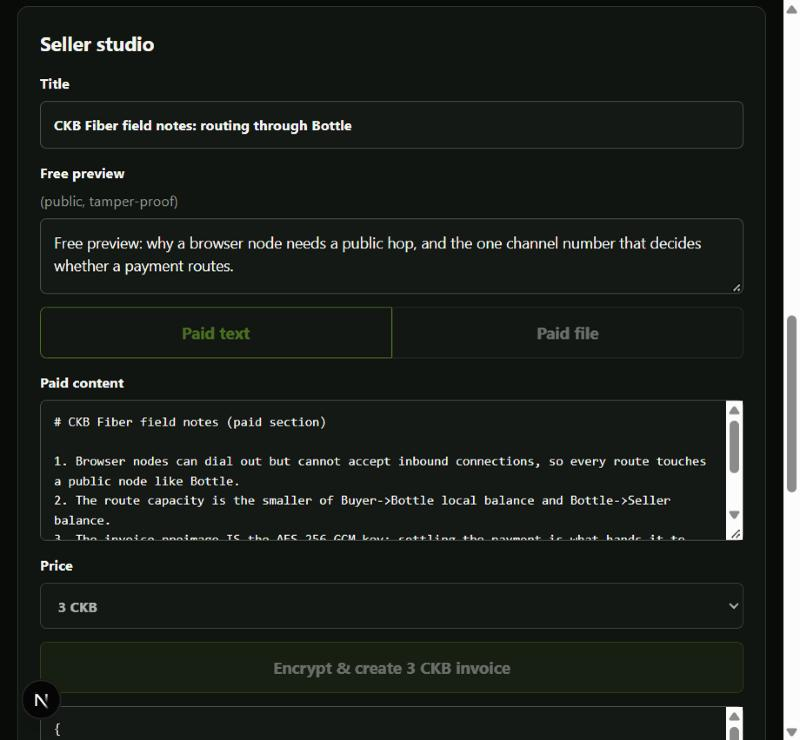
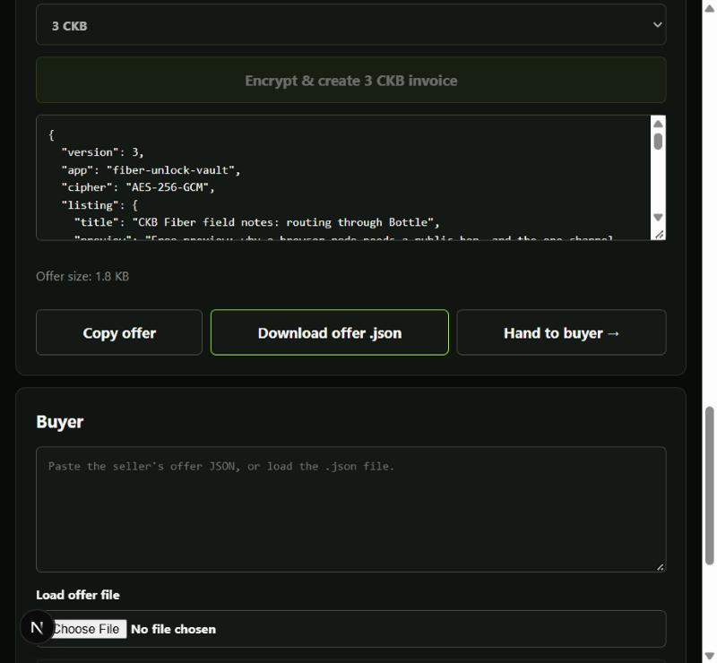
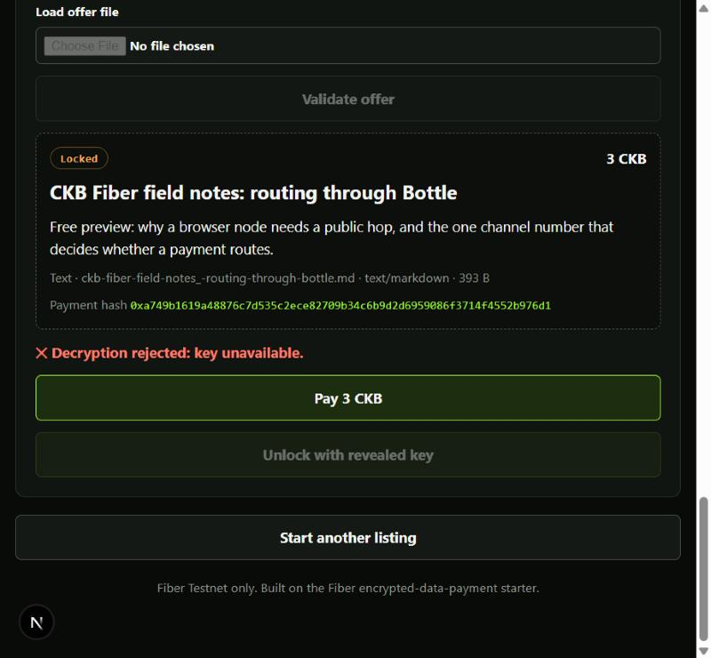
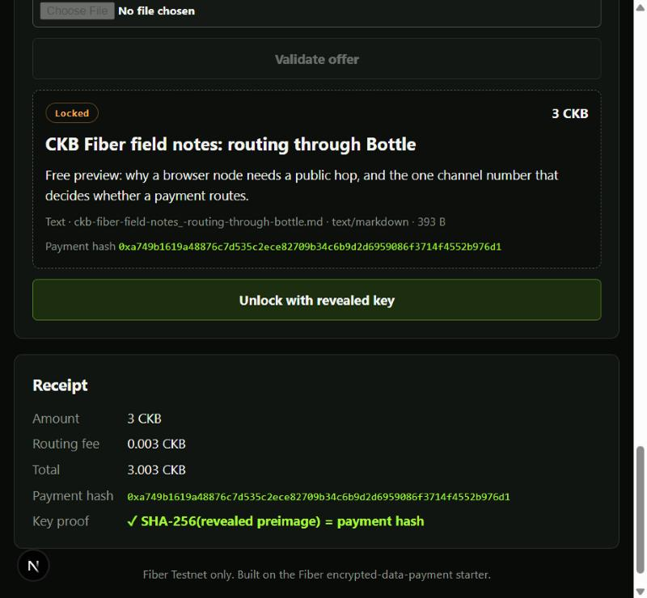
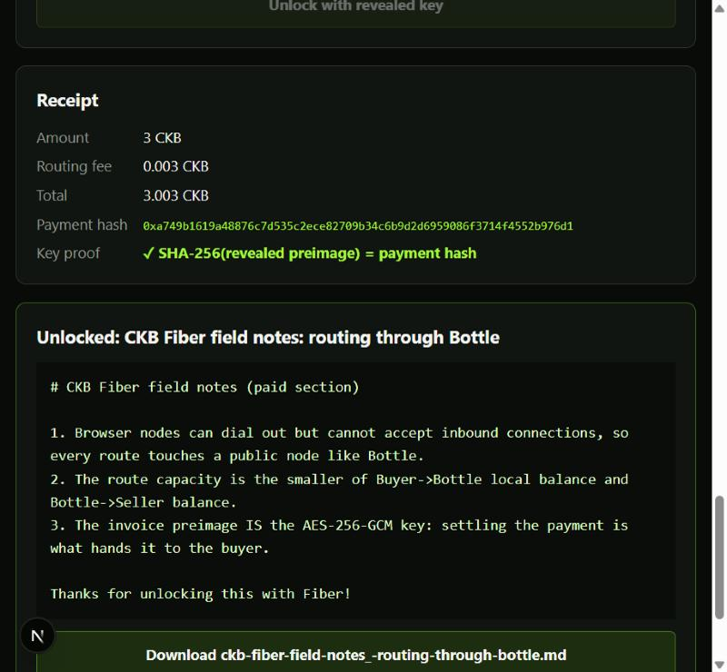
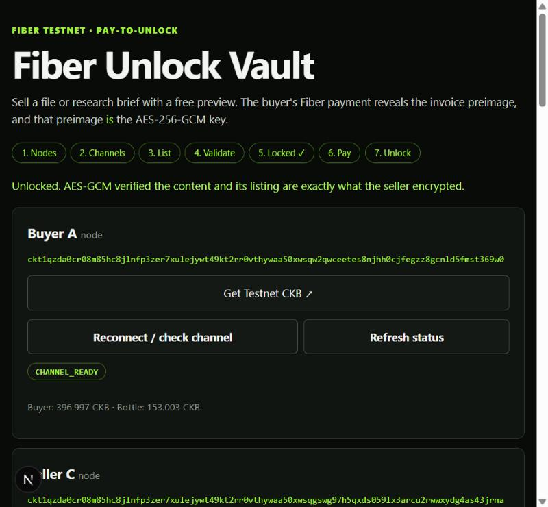

# Quest 2 (Advanced): Fiber Unlock Vault

**Build on CKB, Campaign #8 · Unlock Encrypted Data with a Fiber Payment**

Repo: [github.com/devfoma/fiber-unlock-vault](https://github.com/devfoma/fiber-unlock-vault) · Network: CKB Testnet · Date: 23 November 2026

This is the story of turning the tutorial's starter kit into my own pay-to-unlock app, and then running a real Testnet purchase through it. Each chapter shows what happened, with screenshots, and my reflection at that point.

---

## Chapter 1: The idea

The tutorial ended with a challenge: *sell a research brief with a free summary, or offer a paid file download.* **Fiber Unlock Vault** does both. A seller lists a paid brief or **any file** with a public title and a **free preview**, and sets their own price. When the buyer's Fiber payment settles, it reveals the invoice preimage, and that preimage **is** the AES-256-GCM key.

> **✍️ My reflection: what I'd like to build**
>
> I would build a global library for secrets, mainly code and research. Anyone can upload and earn, and anyone who needs something pays to unlock it. Fiber Unlock Vault is a first step toward that.

---

## Chapter 2: What I changed in the starter

The repo's first commit is the **unmodified starter**, so the second commit shows exactly what's new.

| Area | Starter | Fiber Unlock Vault |
|---|---|---|
| Content | Fixed text sample | Paid text **or any file** up to 512 KB, downloadable after unlock |
| Price | Fixed 1 CKB | Seller picks **1–10 CKB**, and the buyer checks it against the signed invoice |
| Public info | None | **Listing**: title, free preview, file name, type, size, price |
| Tamper resistance | Ciphertext only | The listing and payment hash are bound into AES-GCM as **additional data**. Editing the preview or price, or swapping in another invoice, makes decryption fail even with the real key |
| Invoice check | Network, amount, hash | Also checks the seller-signed description `Unlock: <title>` |
| Receipt | Amount, fee, hash | Adds a local **key proof**: SHA-256(revealed preimage) = payment hash |
| Offer handoff | Copy/paste | Copy, download/load `.json`, or one-click "Hand to buyer" |
| Tests | 9 | 16 (7 new: file round-trip, key never in the offer, tamper rejection, price enforcement, and more) |

The starter's payment safety logic is unchanged: the attempt is recorded before sending, nothing is resubmitted automatically, and status can be recovered after a refresh.

---

## Chapter 3: Getting it running, and what broke

I funded two new nodes (these are separate from the tutorial's, because browser storage is per site) and opened channels to Bottle. A few things went wrong along the way:

1. **"Waiting for peer to send Init message."** The app asked Bottle to open a channel a moment before Bottle had finished its connection handshake. Clicking again a few seconds later worked. **Fix:** the app now waits for Bottle to appear as a peer and retries while the handshake is pending.
2. **Seller showed as "not connected" right after starting**, so the Encrypt button stayed disabled until Refresh was pressed. **Fix:** the same wait-for-peer step runs when a node starts.
3. **A node crashed** (`WASM … unreachable`) with four Fiber nodes running in one browser at once (two for the tutorial, two for the Vault). Reloading the page brought both nodes back with their keys and channels intact.



> **✍️ My reflection: a problem I ran into**
>
> I expected the channels to open on the first click. Instead the channel failed with "waiting for peer to send Init message", and later a node crashed. That was scary. Retrying and reloading brought everything back, and the app now waits for Bottle's handshake so the first error doesn't happen again.

---

## Chapter 4: Listing a paid brief for 3 CKB

In the **Seller studio** I wrote a title and a free preview, added the paid content and chose a price of **3 CKB**. One click encrypted it and created the invoice.



The resulting **v3 offer** contains the listing, the ciphertext and the invoice. It never contains the key.



---

## Chapter 5: The buyer sees what they're buying, locked

The buyer validated the offer: Testnet invoice, signed for this listing, charging exactly the listed price. They then saw the **listing card**, with title, free preview, file details, price and payment hash, marked **Locked**. Decrypting without the key was rejected.



---

## Chapter 6: Paying and proving the key

The buyer paid **3 CKB** plus a 0.003 CKB routing fee through Bottle. Before unlocking, the app checked that the revealed preimage hashes to the payment hash.

Payment hash: `0xa749b1619a48876c7d535c2ece82709b34c6b9d2d6959086f3714f4552b976d1`



> **✍️ My reflection: what stood out?**
>
> What stood out to me is that the payment didn't need a new on-chain transaction.

---

## Chapter 7: Unlocked

The content decrypted, and AES-GCM confirmed that both the content and its listing are exactly what the seller encrypted. The buyer can read it inline or download it under its original file name.





> **✍️ My reflection: the format, and what I'd change**
>
> Having the explanation right next to each step was helpful. I've done an earlier Fiber tutorial, and I like this format more. I wasn't sure why each channel needs to be funded. If I could change one thing, I would add video explanations.

---

## Run it yourself

```sh
git clone https://github.com/devfoma/fiber-unlock-vault
cd fiber-unlock-vault
npm install
npm run dev   # http://localhost:3001
```

Full instructions, checks and security notes are in the [README](../README.md).
