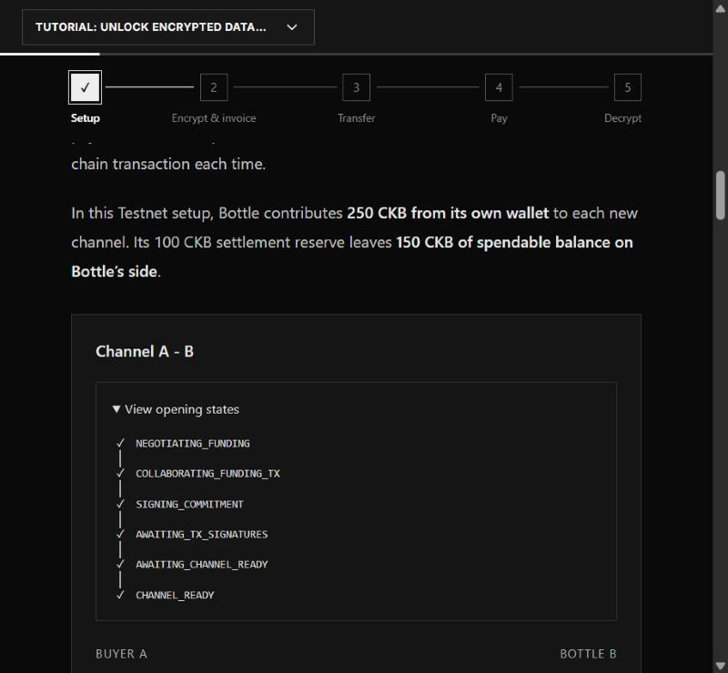
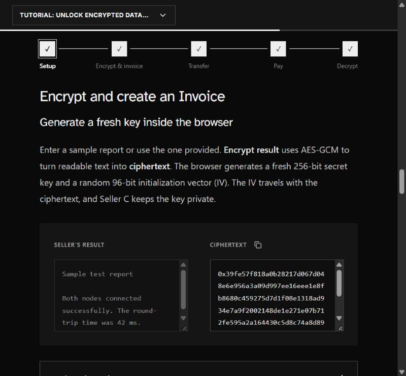
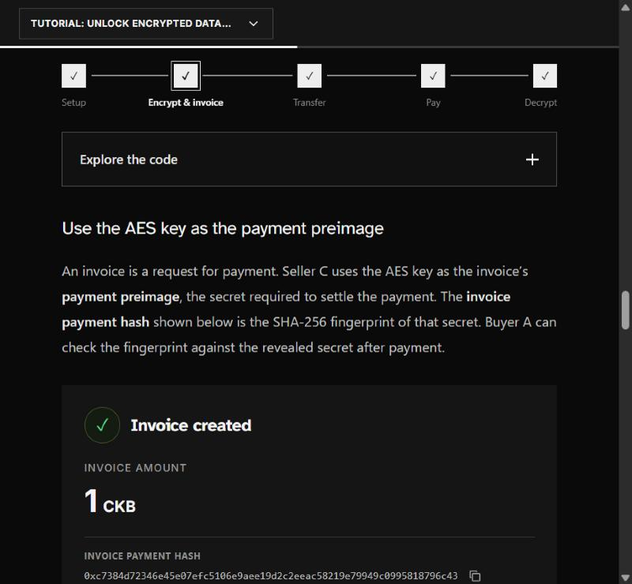
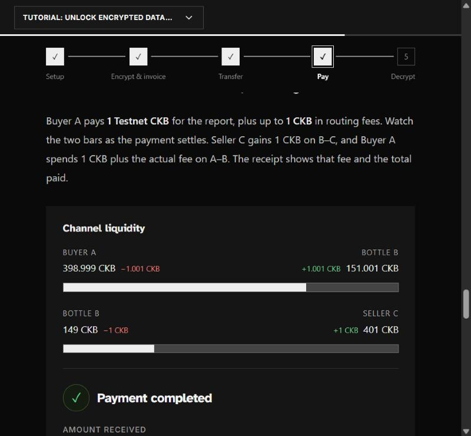
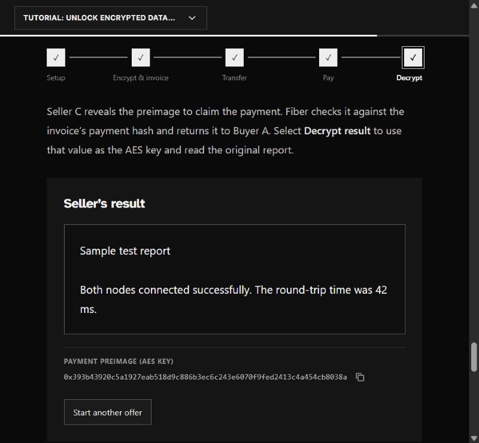

# Quest 1 (Basic): Pay to unlock a report

**Build on CKB, Campaign #8 · Unlock Encrypted Data with a Fiber Payment**

Tutorial: [fiber.world/docs/build/encrypted-data-payment](https://www.fiber.world/docs/build/encrypted-data-payment) · Network: CKB Testnet · Date: 23 November 2026

This is the story of one run through the tutorial, told step by step. Each chapter shows what happened, the screenshot proving it, and my reflection at that point.

| Required proof | Where |
|---|---|
| Both channels showing `CHANNEL_READY` | [Chapter 2](#chapter-2-opening-the-road-through-bottle) |
| Encrypted offer on the buyer side + **Decryption rejected** | [Chapter 4](#chapter-4-the-locked-box-arrives) |
| Receipt showing **1 CKB** and its **payment hash** | [Chapter 5](#chapter-5-paying-1-ckb) |
| Decrypted result matching the seller's original | [Chapter 6](#chapter-6-opening-the-box) |

---

## Chapter 1: Two nodes in one browser tab

I started **Buyer A** and **Seller C**, two Fiber nodes running as WebAssembly inside the page. Each one got a public key and a Testnet funding address. I sent 10,000 Testnet CKB from the [Nervos faucet](https://faucet.nervos.org/) to each address. It confirmed in about 30 seconds, and both nodes showed 10,000 CKB on-chain.

> **✍️ My reflection: having the explanation next to each step**
> *(Required question. How did it feel to have the explanation alongside each interactive step? If you've done an earlier Fiber tutorial with the demo at the top and the walkthrough below, which format worked better and why?)*
>
> _Write your answer here._

---

## Chapter 2: Opening the road through Bottle

Browser nodes can dial out but can't accept incoming connections, so both nodes open a channel to **Bottle B**, a public routing node. Each channel locks 500 CKB on-chain: 400 CKB is spendable and 100 CKB is held back as a settlement reserve. Bottle adds 250 CKB of its own, leaving it 150 CKB to spend.

Both channels went through all six opening stages and reached `CHANNEL_READY` in about 3 minutes.


<details><summary>Close-up of Channel A–B's opening stages</summary>



</details>

> **✍️ My reflection: was any step unclear?**
> *(Optional. Was there a step where you weren't sure what to do next or why it mattered? The 500 CKB breakdown and the 150 CKB route limit are good candidates.)*
>
> _Write your answer here, or delete this box if you don't pick this question._

---

## Chapter 3: Sealing the report and pricing it

As the seller, I encrypted the sample report with AES-256-GCM. The browser generated a fresh 256-bit key and a random IV. The seller then created a **1 CKB invoice** that uses that same AES key as the payment preimage, so the invoice's payment hash is the SHA-256 fingerprint of the key.





---

## Chapter 4: The locked box arrives

The offer JSON reached Buyer A. It holds the invoice, the public `paymentHash`, the `ciphertext`, the `iv` and the last hop to the seller, but **not the key**. I tried to decrypt it anyway with a substitute key, and AES-GCM rejected it.


---

## Chapter 5: Paying 1 CKB

Buyer A paid the invoice. Before sending anything, the buyer checked that the invoice's network, amount and payment hash matched the offer. The payment went A → Bottle → C, and both channel bars moved straight away with no new on-chain transaction.

| | |
|---|---|
| Amount received | **1 CKB** |
| Routing fee | 0.001 CKB |
| Total paid | 1.001 CKB |
| Invoice status | Paid |
| Payment hash | `0xc7384d72346e45e07efc5106e9aee19d2c2eeac58219e79949c0995818796c43` |




> **✍️ My reflection: what stood out about paying to unlock?**
> *(Optional. What surprised you or stood out about paying to unlock the report?)*
>
> _Write your answer here, or delete this box if you don't pick this question._

---

## Chapter 6: Opening the box

To claim the payment, the seller had to reveal the preimage, and Fiber passed it back to the buyer:
`0x393b43920c5a1927eab518d9c886b3ec6c243e6070f9fed2413c4a454cb8038a`.
Using that value as the AES key decrypted the report. It matches the seller's original word for word:

```
Sample test report

Both nodes connected successfully. The round-trip time was 42 ms.
```



> **✍️ My reflection: what would I build, and what would I change?**
> *(Optional, pick either or both. What would you like to build with this pay-to-unlock flow? If you could change one thing about the tutorial, what would it be?)*
>
> _Write your answer here, or delete this box if you don't pick these questions._

---

### Required by the form but not in this page

- **Telegram handle** goes in the CKBoost form itself.
- **Reflection:** answer the required question plus at least two others, in the boxes above.
