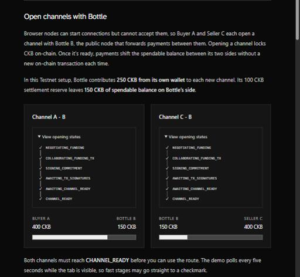
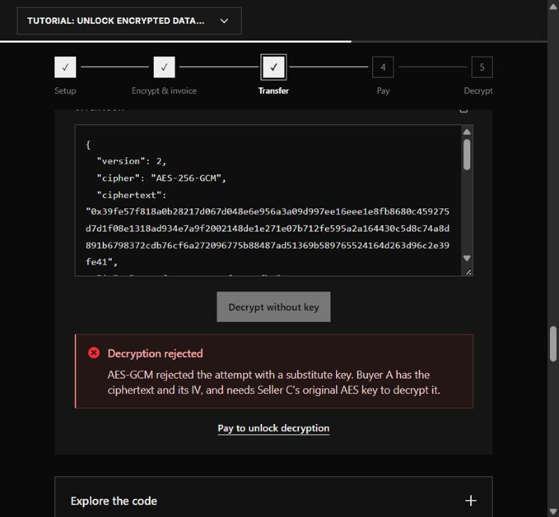
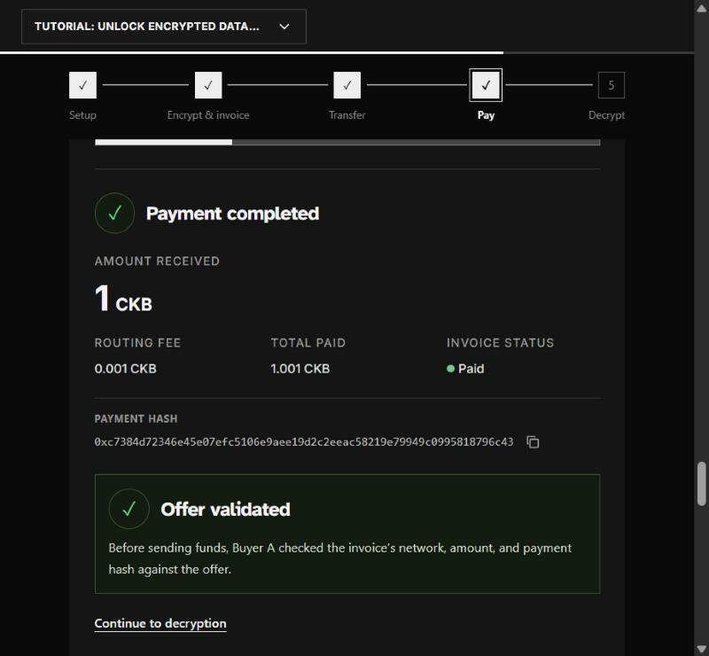

# Quest 1 (Basic): Pay to unlock a report

**Build on CKB, Campaign #8 · Unlock Encrypted Data with a Fiber Payment**

Tutorial: [fiber.world/docs/build/encrypted-data-payment](https://www.fiber.world/docs/build/encrypted-data-payment) · Network: CKB Testnet · Date: 23 November 2026

| Required proof | Where |
|---|---|
| Both channels showing `CHANNEL_READY` | [Step 2](#step-2-i-opened-channels-through-bottle) |
| Encrypted offer on the buyer side + **Decryption rejected** | [Step 4](#step-4-i-tried-to-decrypt-without-the-key) |
| Receipt showing **1 CKB** and its **payment hash** | [Step 5](#step-5-i-paid-1-ckb) |
| Decrypted result matching the seller's original | [Step 6](#step-6-i-decrypted-the-report) |

---

## Step 1: I started my two nodes

I started **Buyer A** and **Seller C**, two Fiber nodes running as WebAssembly inside the page. Each one got a public key and a Testnet funding address. I sent 10,000 Testnet CKB from the [Nervos faucet](https://faucet.nervos.org/) to each address. It confirmed in about 30 seconds, and both nodes showed 10,000 CKB on-chain.

> **✍️ My reflection: having the explanation next to each step**
>
> Having the explanation right next to each step was helpful. I've done an earlier Fiber tutorial, and I like this format more.

---

## Step 2: I opened channels through Bottle

My browser nodes can dial out but can't accept incoming connections, so I opened a channel from each of them to **Bottle B**, a public routing node. Each channel locked 500 CKB on-chain: 400 CKB is spendable and 100 CKB is held back as a settlement reserve. Bottle added 250 CKB of its own, leaving it 150 CKB to spend.

Both of my channels went through all six opening stages and reached `CHANNEL_READY` in about 3 minutes.



<details><summary>Close-up of my Channel A–B opening stages</summary>


</details>

> **✍️ My reflection: was any step unclear?**
>
> I wasn't sure why each channel needs to be funded.

---

## Step 3: I encrypted the report and created a 1 CKB invoice

As the seller, I encrypted the sample report with AES-256-GCM. My browser generated a fresh 256-bit key and a random IV. I then created a **1 CKB invoice** that uses that same AES key as the payment preimage, so the invoice's payment hash is the SHA-256 fingerprint of the key.


---

## Step 4: I tried to decrypt without the key

The offer JSON arrived on my buyer side. It holds the invoice, the public `paymentHash`, the `ciphertext`, the `iv` and the last hop to the seller, but **not the key**. I tried to decrypt it anyway with a substitute key, and AES-GCM rejected it.



---

## Step 5: I paid 1 CKB

I paid the invoice from Buyer A. Before sending anything, my buyer checked that the invoice's network, amount and payment hash matched the offer. The payment went A → Bottle → C, and both channel bars moved straight away with no new on-chain transaction.

| | |
|---|---|
| Amount received | **1 CKB** |
| Routing fee | 0.001 CKB |
| Total paid | 1.001 CKB |
| Invoice status | Paid |
| Payment hash | `0xc7384d72346e45e07efc5106e9aee19d2c2eeac58219e79949c0995818796c43` |




> **✍️ My reflection: what stood out about paying to unlock?**
>
> What stood out to me is that the payment didn't need a new on-chain transaction.

---

## Step 6: I decrypted the report

My seller revealed the preimage to claim the payment, and Fiber passed it back to my buyer:
`0x393b43920c5a1927eab518d9c886b3ec6c243e6070f9fed2413c4a454cb8038a`.
I used that value as the AES key and decrypted the report. It matches the seller's original word for word:

```
Sample test report

Both nodes connected successfully. The round-trip time was 42 ms.
```


> **✍️ My reflection: what would I build, and what would I change?**
>
> I would build a global library for secrets, mainly code and research. Anyone can upload and earn, and anyone who needs something pays to unlock it.
>
> If I could change one thing about the tutorial, I would add video explanations.
