# Build on CKB Campaign #8: proofs of completion

Everything below was run on **CKB Testnet** on 23 November 2026 with browser (WASM) Fiber nodes routing through the public Bottle node.

- [Quest 1 (Basic): tutorial walkthrough](#quest-1-basic-pay-to-unlock-a-report)
- [Quest 2 (Advanced): Fiber Unlock Vault](#quest-2-advanced-fiber-unlock-vault)

---

## Quest 1 (Basic): Pay to unlock a report

Tutorial: [Unlock Encrypted Data with a Fiber Payment](https://www.fiber.world/docs/build/encrypted-data-payment)

### 1. Setup: both channels showing `CHANNEL_READY`

Channel A–B (Buyer A ↔ Bottle) and Channel C–B (Bottle ↔ Seller C), every opening stage checked through `CHANNEL_READY`.

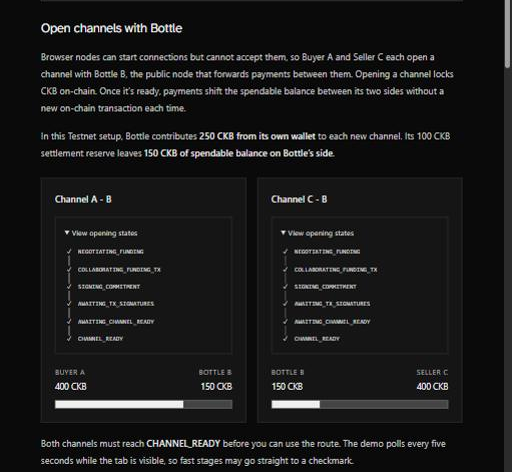

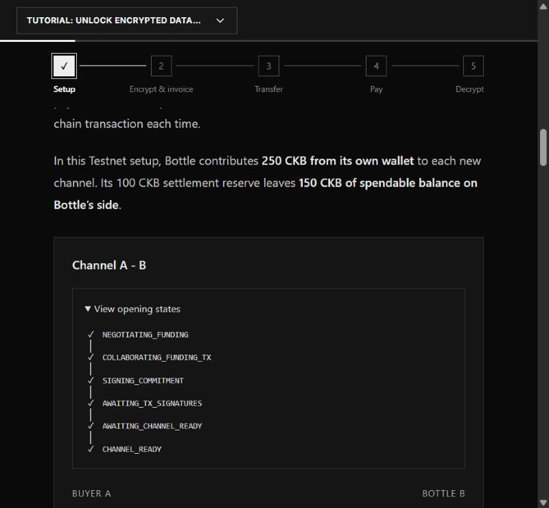

### 2. Before payment: encrypted offer on the buyer side and **Decryption rejected**

The seller's sample report and its AES-256-GCM ciphertext, the 1 CKB invoice, then the offer JSON delivered to Buyer A. Decrypting without the key is rejected.

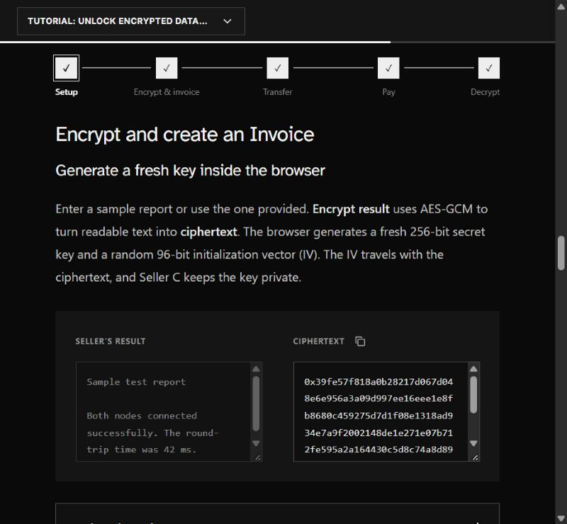

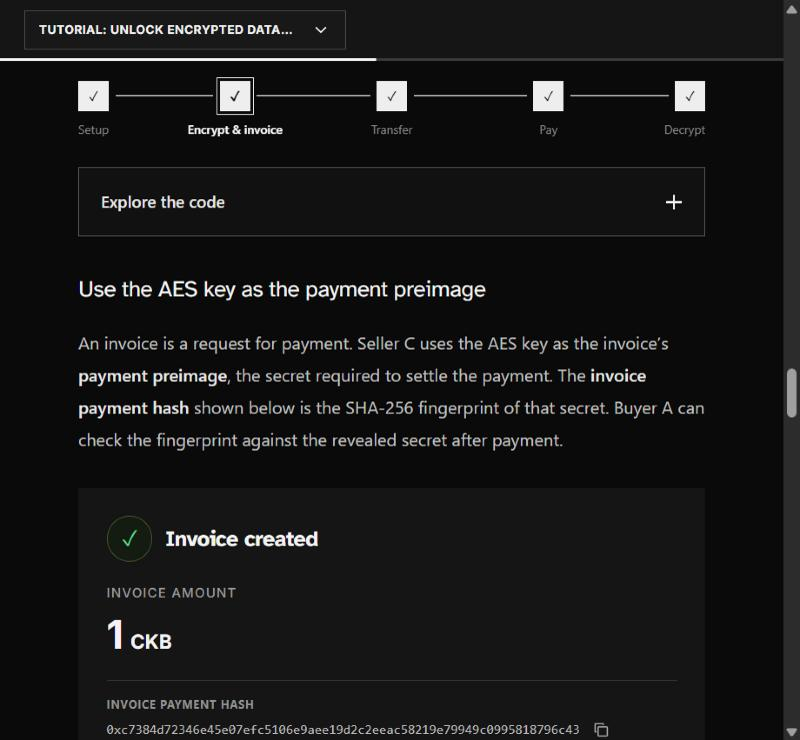

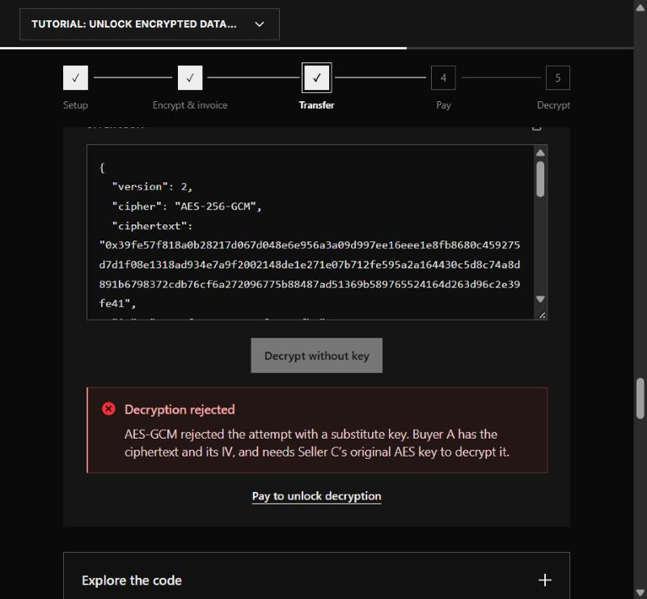

### 3. After payment: receipt showing **1 CKB** and the **payment hash**

- Amount received: **1 CKB**
- Routing fee: 0.001 CKB, total paid 1.001 CKB, invoice status **Paid**
- Payment hash: `0xc7384d72346e45e07efc5106e9aee19d2c2eeac58219e79949c0995818796c43`

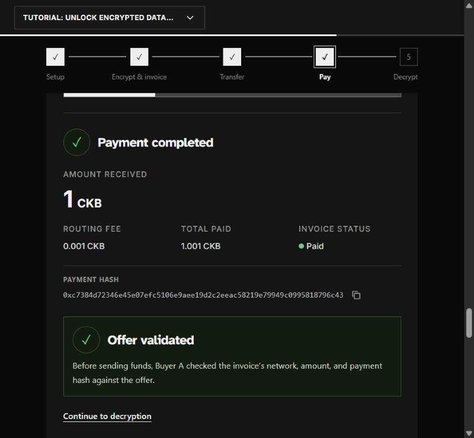

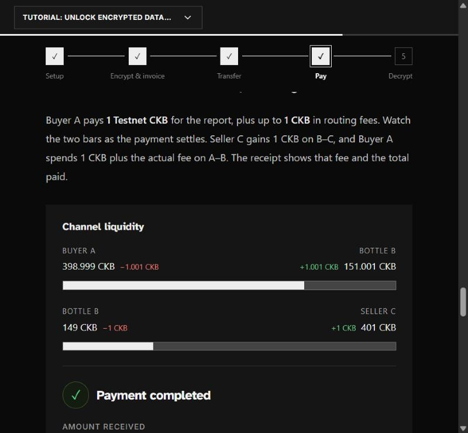

### 4. After decryption: result matches the seller's original

Seller's original (before encryption):

```
Sample test report

Both nodes connected successfully. The round-trip time was 42 ms.
```

Buyer's decrypted result using the revealed preimage `0x393b43920c5a1927eab518d9c886b3ec6c243e6070f9fed2413c4a454cb8038a` as the AES key: identical text.

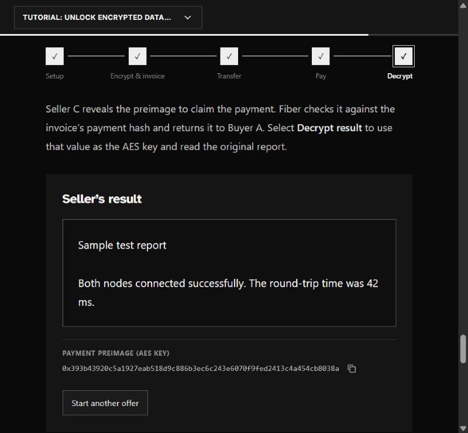

---

## Quest 2 (Advanced): Fiber Unlock Vault

Repo: https://github.com/devfoma/fiber-unlock-vault (see the [README](../README.md) for what changed from the starter).

The run below sells a paid research brief with a public, tamper-proof free preview at a seller-chosen price of **3 CKB**.

| Step | Screenshot |
|---|---|
| All seven steps complete | 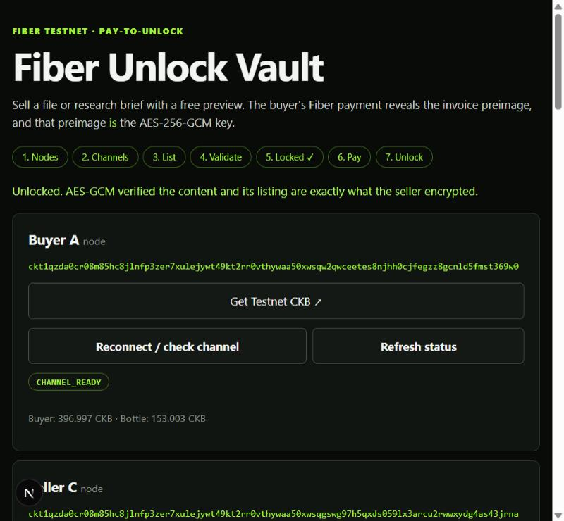 |
| Both channels `CHANNEL_READY` | 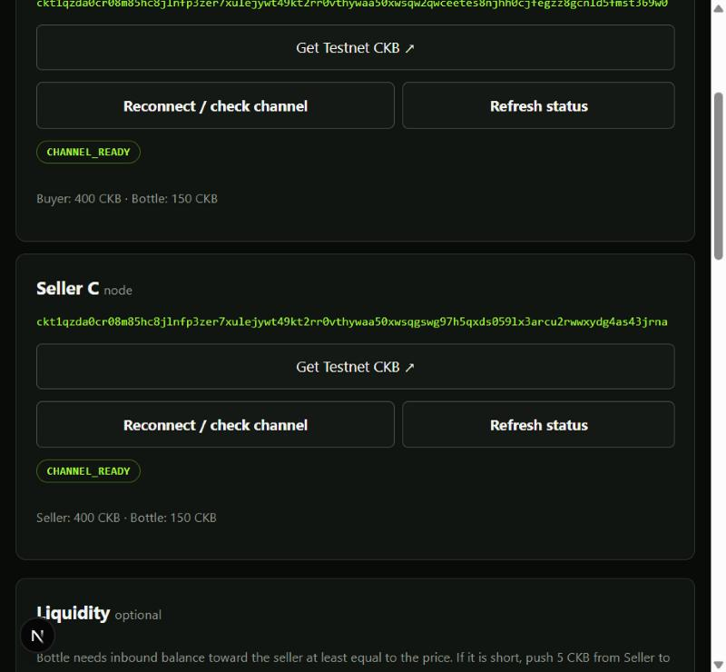 |
| Seller studio: title, free preview, paid text, price 3 CKB | 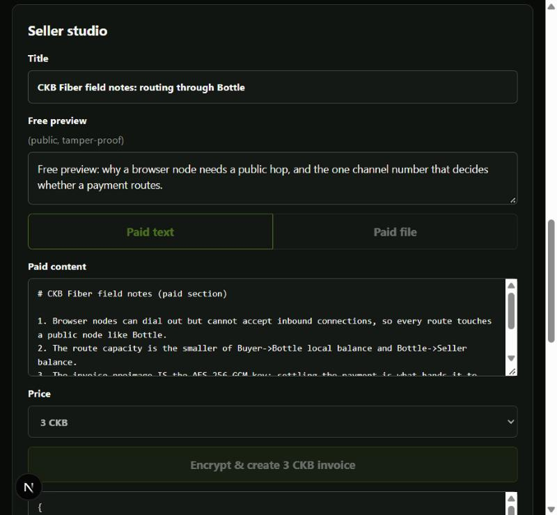 |
| v3 offer generated (listing + ciphertext + invoice, no key) | 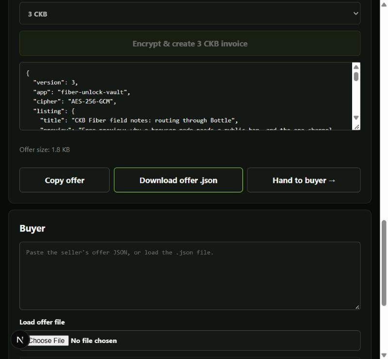 |
| Buyer validates the offer, sees the locked listing card, decryption rejected | 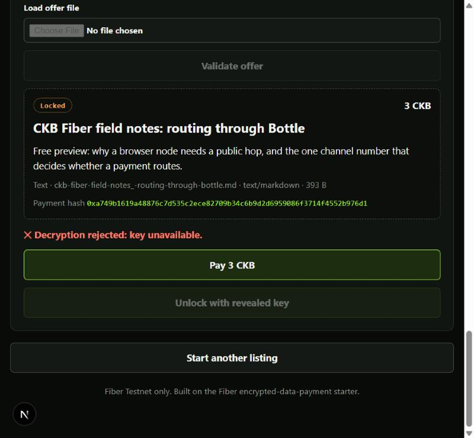 |
| Receipt: 3 CKB, fee, payment hash, **key proof** SHA-256(preimage) = hash | 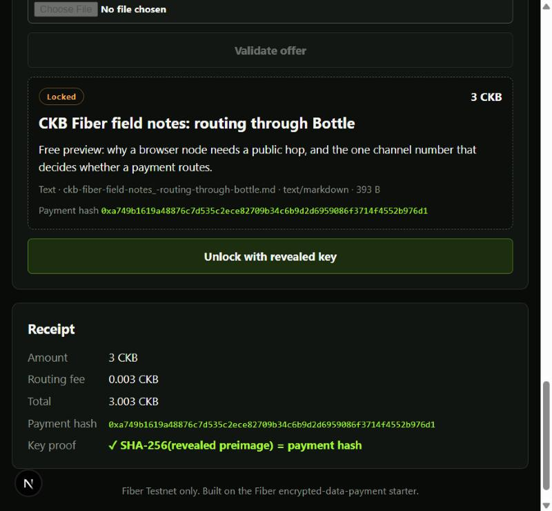 |
| Content unlocked, with file download | 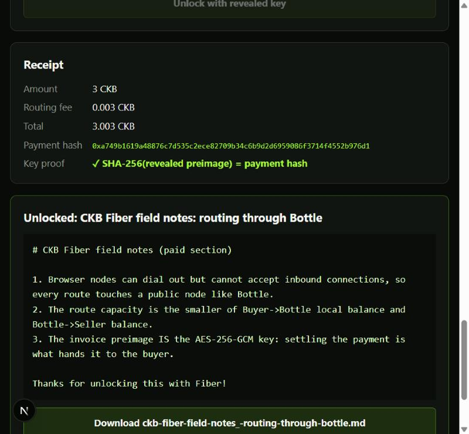 |

Payment hash for this run: `0xa749b1619a48876c7d535c2ece82709b34c6b9d2d6959086f3714f4552b976d1` (3 CKB + 0.003 CKB routing fee).
